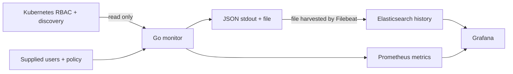

# Kubernetes RBAC access monitor

**Who can access what in Kubernetes—and how has that changed?**

This read-only Go service collects RBAC grants for a supplied inventory of users
and groups. It records permissions over time and highlights how many monitored
users have sensitive access.

## What it does

- Collects immediately, then every five minutes by default.
- Resolves user/group bindings while preserving scope, API groups, verbs,
  subresources, name restrictions and role/binding provenance.
- Writes one JSON record per user to stdout and a rotating file, including users
  with no grants. Filebeat ships the file records to Elasticsearch.
- Publishes distinct-user sensitive-access counts to Prometheus.
- Provides Grafana dashboards for user permissions/history, sensitive exposure,
  and service health.

The monitor does not change cluster RBAC, read Secret contents, or impersonate users.
Results describe **observed RBAC grants**, not a live authorization guarantee.
Group membership comes from the supplied inventory.

## Explore the solution

| Document | What you will find |
| --- | --- |
| [System design](docs/system-design.md) | Architecture, one collection cycle, data model and failure boundaries |
| [Decisions and tradeoffs](docs/decisions-and-tradeoffs.md) | Why this solution was chosen, what it gives up, and next improvements |
| [Operations](docs/operations.md) | Prerequisites, Compose setup, configuration, dashboards and troubleshooting |

The local stack uses Go, Kubernetes client-go, Filebeat, Elasticsearch, Prometheus
and Grafana, provisioned through Docker Compose. Start with the
[operations guide](docs/operations.md#first-time-local-setup) to configure authorized
credentials and user input before starting collection. Real inventory, kubeconfig
and passwords must remain outside Git.
