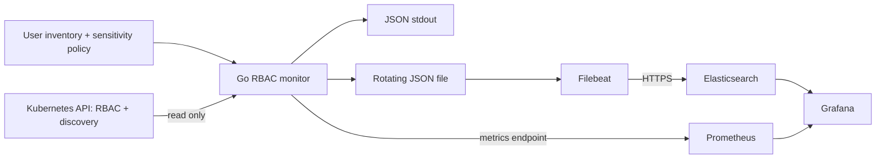

# System design: from RBAC rules to useful answers

## The question we want to answer

“Who can read Secrets—and who had that permission yesterday?”

Kubernetes stores the pieces of that answer in Roles, ClusterRoles and their
bindings. This service joins those pieces for a supplied user inventory, records
the result over time, and makes sensitive exposure visible.

It is an **observer, not an enforcement system**. It never changes cluster RBAC,
reads Secret contents, or attempts actions as another user.

## The architecture



The Go service owns permission resolution and counting. Filebeat owns delivery to
Elasticsearch. Prometheus stores aggregate metrics. Grafana provides three views:
user access, sensitive exposure, and service health. Docker Compose wires them
together; setup provisions certificates, indices and scoped Elasticsearch users.

## Follow one collection cycle

1. **Load the subjects.** At startup, validate the supplied JSON inventory and policy.
   Only these users and their supplied groups are monitored.
2. **Read the cluster.** Run immediately, then every five minutes. Fetch paginated
   RBAC and namespace lists, plus discovery metadata for resource scope.
3. **Resolve grants.** Match user/group subjects to bindings and referenced roles.
   Preserve namespace versus cluster scope, API group, subresources, verbs,
   resource-name restrictions, and role/binding provenance.
4. **Count exposure.** Evaluate the configured sensitive resource/verb pairs and
   count distinct monitored usernames—not bindings or matching rules.
5. **Publish the observation.** Update metrics, then independently attempt checked
   stdout and file writes. Emit a record even for a user with no grants.
6. **Index the history.** Filebeat harvests the file, routes access and diagnostic
   events into separate indices, and retries delivery using its persisted state.

Only one collection runs at a time. Missed schedule slots are skipped instead of
creating catch-up bursts. Request retries, pagination and rate waits share a bounded
collection budget; synchronous output can extend beyond that budget.

## Keep the evidence, not just the answer

Each user record carries a shared snapshot ID, observation/start times,
`expected_users`, supplied groups, resource/non-resource grants and provenance.
A stable event ID derived from snapshot and username becomes the Elasticsearch
document ID, making replay of that event idempotent.

Resource grants use a **nested Elasticsearch mapping**. This prevents combining
`get pods` from one rule with `delete secrets` from another and falsely reporting
`get secrets`. Native verbs remain native: reading normally means `get`, `list`
or `watch`; pod execution is a subresource permission such as `create pods/exec`.

Scope matters too: a RoleBinding does not grant cluster-wide access. A
ClusterRoleBinding granting namespaced resources can apply across namespaces.
Name restrictions remain visible, rather than becoming unrestricted permissions.

## Two kinds of questions, two storage paths

| Question | Where it is answered |
| --- | --- |
| What permissions did this user have in one observation? | Elasticsearch snapshot tables |
| Who was observed with a particular resource/verb permission in a time range? | Elasticsearch historical matching |
| How many monitored users have sensitive access? | Prometheus gauges and history |
| Is the collector running and producing fresh results? | Service-health metrics and diagnostics |

The two required metrics retain their original labels:

```text
k8s_namespace_sensitive_access_users_count{namespace,verb,resource}
k8s_cluster_wide_sensitive_access_users_count{resource,verb}
```

Usernames and provenance stay in records, not metric labels. The sensitivity policy
is restricted to core API resources because these metric labels cannot distinguish
API groups. Applicable name-restricted grants count as exposure; unusable
name-restricted top-level `create`/`deletecollection` grants do not.

## Be explicit about success

An unresolved relevant role or unknown resource scope fails the observation rather
than publishing a partial success. After failure, metrics retain the last complete
counts **with their old freshness**. Before the first success, access counts are
unknown, not zero. A restart does not restore a previous in-memory observation.

Collection, stdout, file acceptance and Elasticsearch delivery are separate success
boundaries. Fresh metrics do not prove fresh Elasticsearch history. A failed sink
does not prevent attempting the other sink; writing the file is not a delivery
acknowledgement.

The dashboard's complete-snapshot dropdown checks distinct usernames, consistent
positive expected counts on every document, and matching document counts. It
rejects partial or duplicate snapshots. This is **indexed completeness**, not an
atomic Kubernetes snapshot: the API lists themselves are separate reads.

## What the demonstration does—and does not—claim

- It reconstructs **recorded RBAC grants**, not a live authorization decision.
  Supplied groups are trusted input; identity-provider membership, other authorizers,
  admission decisions and object existence are not evaluated.
- Historical matching means “observed at least once in this range,” not continuous
  permission between samples.
- Complete snapshots are validated by the dropdown, not each table query. Restored
  or hand-edited URLs can bypass that validation. Snapshot selection stays fixed;
  dashboard refresh does not automatically switch to the newest snapshot.
- Snapshot candidates and query results are bounded. Retention, backup, alerting
  and prolonged-outage recovery need additional production work.

For a presentation, follow the diagram, walk through one collection, then show
`secrets/get` history and the sensitive-user counts. Finish by distinguishing
**observed permission**, **fresh collection**, and **confirmed delivery**.
